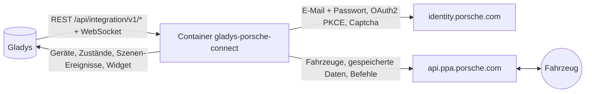
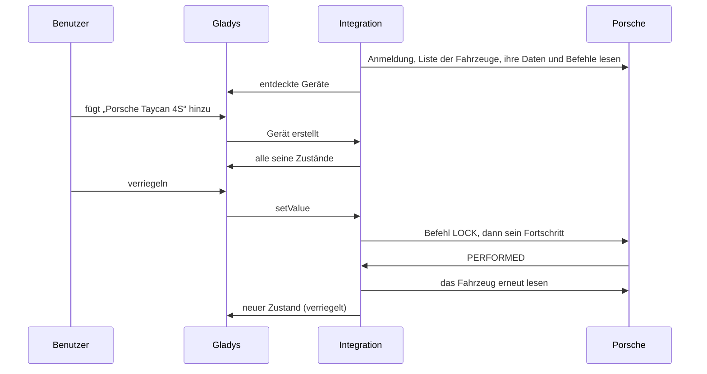
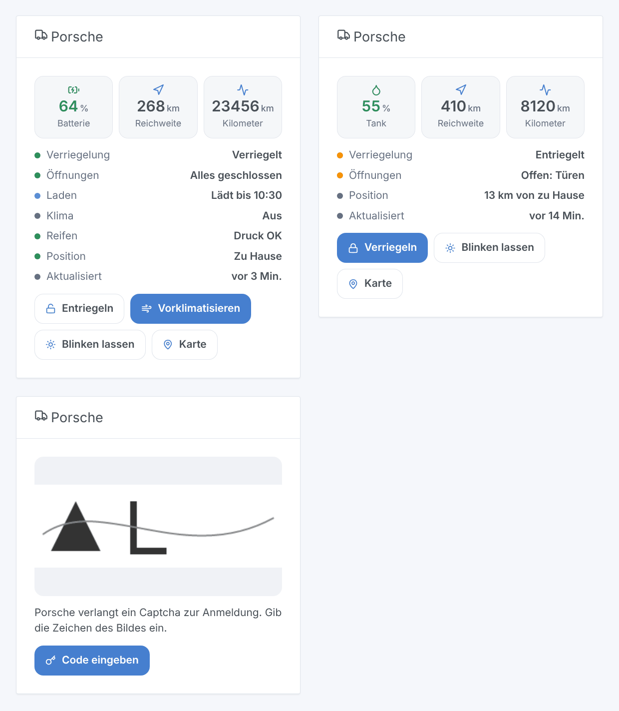

# Gladys Porsche Connect

[English](README.md) · [Français](README.fr.md) · **Deutsch** · [Español](README.es.md)

[](LICENSE)
[](https://github.com/William-De71/gladys-porsche-connect/releases)
[](https://github.com/William-De71/gladys-porsche-connect/actions/workflows/release.yml)
[](https://gladysassistant.com)


Externe Integration für [Gladys Assistant](https://gladysassistant.com) für **Porsche-Fahrzeuge mit Porsche Connect**: Batterie oder Tank, Reichweite, Kilometerstand, Verriegelung, Öffnungen, Laden, Klimatisierung, Reifen, Position, mit Befehlen, Szenen und einem Dashboard-Widget. Sie spricht mit deinem Konto mit den Servern der My-Porsche-App, wie die Bibliothek [pyporscheconnectapi](https://github.com/CJNE/pyporscheconnectapi) und ihre [Home-Assistant-Integration](https://github.com/CJNE/ha-porscheconnect).

Benutzerdokumentation: [English](docs/en.md) · [Français](docs/fr.md) · [Deutsch](docs/de.md) · [Español](docs/es.md).

> Community-Integration, weder mit Porsche verbunden noch von Porsche unterstützt. Die Server der My-Porsche-App haben keine öffentliche Dokumentation: Porsche kann sie jederzeit ändern.

## Funktionen

- **Ein Gerät pro Fahrzeug** des Kontos: Batterie und elektrische Reichweite, Tank und Gesamtreichweite, Kilometerstand, Verriegelung, Türen, Kofferraum, Fronthaube, Fenster, Schiebedach oder Verdeck, Ladekabel, Laden, Ladestatus und -leistung, Ladeziel, Vorklimatisierung, Druck der vier Reifen, Wartung, Entfernung von zu Hause.
- **Befehle**, wenn das Fahrzeug sie annimmt: verriegeln, entriegeln (mit der PIN der App), Vorklimatisierung mit der gewählten Temperatur, Ladeziel, Direktladen, Blinken, Hupe und Blinker.
- **Abfragen, die das Fahrzeug nie aufwecken**: Die Integration liest die Daten, die das Fahrzeug zuletzt an Porsche gesendet hat, standardmäßig alle 15 Minuten.
- **7 Szenen-Auslöser**, **2 Szenen-Aktionen** und **1 Dashboard-Widget** (siehe unten), das auch das **Captcha** zeigt, das Porsche bei der Anmeldung manchmal verlangt.
- Eine Schaltfläche **Diagnose**, die ins Protokoll schreibt, was jedes Fahrzeug meldet, ohne FIN und Position.
- Überall vier Sprachen: Englisch, Französisch, Deutsch, Spanisch.

## Funktionsweise




Vom Scan zum Befehl:



Die Anmeldung ist die der App: die „Identifier first“-Seiten von Auth0 (erst E-Mail, dann Passwort), dann der Code-Austausch (OAuth2 + PKCE). Die Integration lehnt das Passkey-Angebot ab, behält die Tokens in `/data/session.json` und erneuert sie: Nach einem Neustart meldet sie sich nicht erneut an. Verlangt Auth0 ein **Captcha**, pausiert die Anmeldung und das Dashboard-Widget zeigt das Bild mit einem Formular; deine Antwort setzt dieselbe Anmeldung fort (dieselben Cookies), 10 Minuten lang. Ein abgelehntes Passwort, ein Captcha oder ein gesperrtes Konto warten auf dich: Die Integration versucht sie nie in einer Schleife erneut.

Jede Abfrage liest die **gespeicherte Übersicht** jedes Fahrzeugs (was es beim Parken, beim Laden oder nach einem Befehl gesendet hat): Sie weckt das Fahrzeug nie auf, so wird seine 12-V-Batterie geschont. Solange Porsche die Anfragen begrenzt (HTTP 429), werden die Abfragen seltener (30 Minuten, verdoppelt bis zu 4 Stunden).

### Transport

`transports: ["cloud"]`: Alles läuft über die Porsche-Server, das Fahrzeug wird nie in deinem Netzwerk angesprochen. Der Zustand deiner Fahrzeuge (inklusive Position) kommt aus der Porsche-Cloud; die Integration sendet Porsche deine E-Mail, dein Passwort und die Befehle. Das Transport-Badge eines Fahrzeugs zeigt `cloud`, `unreachable`, wenn Porsche das Konto ablehnt oder auf ein Captcha wartet, und den orangen Punkt des eingeschränkten Modus, solange Porsche die Anfragen begrenzt.

## Geräte und Funktionen

| Gerät            | Funktionen (Kategorie / Typ)                                                                                                                                                                                                                                                                                                                                                                                                                                                                                                                                                                                                                                                                                                                 |
| ---------------- | -------------------------------------------------------------------------------------------------------------------------------------------------------------------------------------------------------------------------------------------------------------------------------------------------------------------------------------------------------------------------------------------------------------------------------------------------------------------------------------------------------------------------------------------------------------------------------------------------------------------------------------------------------------------------------------------------------------------------------------------- |
| Porsche-Fahrzeug | Batterie (`electrical-vehicle-battery` / `battery-level`), elektrische Reichweite (`battery-range-estimate`), Tankfüllstand (`level-sensor` / `liquid-level-percent`), Gesamtreichweite und Strecke bis zur Wartung (`distance-sensor` / `decimal`, km), Kilometerstand (`electrical-vehicle-state` / `odometer`), Verriegelung (`electrical-vehicle-command`), Türen, Kofferraum, Fronthaube (`door-opened`), Fenster, Schiebedach oder Verdeck (`window-opened`), Reifendruck (`tire-pressure`, bar), Kabel angesteckt, Laden, Ladeleistung, Ladeziel (`electrical-vehicle-charge`), Vorklimatisierung (`electrical-vehicle-climate` / `climate-on`), Tage bis zur Wartung (`duration`), Ladestatus (`text`), Entfernung von zu Hause (km) |

Eine Funktion erscheint, sobald das Fahrzeug ihren Wert meldet; das Gerät wird erneut angeboten, wenn eine neue hinzukommt. Verriegelung, Vorklimatisierung und Ladeziel sind Befehle, wenn das Fahrzeug sie annimmt, sonst nur lesbar.

## Szenen-Auslöser, -Aktionen und Widgets



- **Auslöser**: ver- oder entriegelt, verriegelt, aber offen, Ladestatus geändert, Kabel an- oder abgesteckt, zu Hause angekommen oder losgefahren (Häuser in Gladys mit Position, Radius um das Zuhause aus den Einstellungen), Reifendruck niedrig, Kontoproblem (Passwort, Captcha, gesperrtes Konto, zu viele Anfragen). Jeder Fahrzeug-Auslöser lässt sich nach Fahrzeug filtern; sie werden bei der nächsten Abfrage erkannt.
- **Aktionen**: Befehl senden (wartet bis zu 100 s, bis das Fahrzeug ihn ausführt: `success`, `status`, `summary`), Status lesen (Verriegelung, Öffnungen, Batterie, Tank, Reichweite, Laden, Reifen, Position, Kartenlink, ein fertiger Satz).
- **Widget** „Porsche“: Batterie oder Tank, Reichweite, Kilometerstand, Statusliste, Tasten ver-/entriegeln, vorklimatisieren, blinken lassen, Karte; das Captcha und sein Formular, wenn Porsche eines verlangt.

Beispiele:

- Wenn das Fahrzeug verriegelt, aber offen ist → eine Benachrichtigung mit `{{triggerEvent.data.summary}}` senden.
- Wenn der Ladestatus „Laden abgeschlossen“ wird → benachrichtigen und die Ladesteckdose ausschalten.
- An Wintermorgen werktags um 7:30 → den Befehl „Vorklimatisierung starten“ senden.
- Wenn ein Kontoproblem „Captcha einzugeben“ ist → mir eine Nachricht senden, damit ich das Dashboard öffne.

## Voraussetzungen

- Gladys Assistant **5.3.0** oder neuer (das Captcha-Formular des Widgets, der Katalog mit Schlüsselwörtern/Ländern von Gladys 5.3): Ältere Instanzen können die Integration nicht installieren.
- Ein Porsche mit aktivem Porsche-Connect-Vertrag (Taycan, Macan Electric, 911 ab dem 992, 718, Panamera ab 2021, Cayenne ab 2017) und das Konto der My-Porsche-App.
- Das Widget **Porsche** auf einem Dashboard, um ein Captcha zu beantworten.

## Installation

- **Aus dem Store**: Integrationen → Porsche Connect → Installieren.
- **Über die Repository-URL**: Integrationen → externe Integration → `https://github.com/William-De71/gladys-porsche-connect`.
- **Entwicklermodus**: `npm start` mit den von Gladys gelieferten Variablen starten (siehe Entwicklung).

## Konfiguration

| Feld                             | Standard    | Bedeutung                                                               |
| -------------------------------- | ----------- | ----------------------------------------------------------------------- |
| E-Mail / Passwort                | —           | Das My-Porsche-Konto (das Passwort ist ein `secret`)                    |
| PIN (4 Ziffern)                  | —           | Die PIN der App, nur zum Entriegeln aus Gladys                          |
| Abfrageintervall                 | 15 Min.     | 10, 15, 30 oder 60 Minuten zwischen zwei Abfragen                       |
| Temperatur der Vorklimatisierung | 21 °C       | 18 bis 24 °C, im Bereich, den das Fahrzeug annimmt                      |
| Radius um das Zuhause            | 200 m       | Entfernung zu einem Haus in Gladys, unter der das Fahrzeug zu Hause ist |
| Sprache der Texte                | automatisch | Namen, Zustände und Szenen-Zusammenfassungen                            |

## Verwendung

1. Füge das Widget **Porsche** einem Dashboard hinzu.
2. Trage das Konto ein, klicke auf **Speichern** und dann auf **Verbindung testen**. Zeigt das Widget ein Captcha, gib es dort ein.
3. Öffne **Entdecken**, füge deine Fahrzeuge hinzu und erstelle Szenen mit den Auslösern und Aktionen.

## Entwicklung

```bash
npm install
npm test                       # node --test, never touches the network
npm run lint                   # ESLint
npm run format:check           # Prettier
npx github:GladysAssistant/integration-store . --skip-image-check
scripts/build-cover.sh         # cover.jpg from docs/assets/cover.svg
docs/illustrations/render.sh   # docs/assets/widgets.<lang>.png
```

Lokal liest das SDK `GLADYS_HOST_API_URL`, `GLADYS_INTEGRATION_TOKEN` und `GLADYS_INTEGRATION_SELECTOR` (von Gladys im Entwicklermodus geliefert). `DEBUG=gladys-integration-sdk` zeigt die Protokolle des SDK.

Die Tests laufen gegen eine nachgebaute Porsche-Cloud (`test/helpers/fixtures.js`: Auth0-Seiten mit Captcha und Passkey, Token-Endpunkt, PPA-API mit Befehlen), rekonstruiert aus dem Code von pyporscheconnectapi und evcc: Anmeldeschritte (Captcha, Passkey, falsches Passwort, Erneuerung, gespeicherte Sitzung), Befehle und ihr Fortschritt, der Hash der PIN, die Momentaufnahmen, die Geräte (Pflichtfelder der Entdeckung, Kategorie-/Typ-Paare und Einheiten des Kerns), das Widget (`validateWidgetContent`, `validateWidgetImage`), Szenen-Ereignisse und -Ausgaben, das Manifest, die vier Sprachen, das Release-Skript und die ganze Integration gegen das Fake-Gladys des SDK. `test/structure.test.js` friert jeden gespeicherten Schlüssel ein.

## Release-Prozess


Jeder Merge auf `main` startet die CI und berechnet dann die Version aus den [Conventional Commits](https://www.conventionalcommits.org/) seit dem letzten Tag: `feat` → Minor, `fix` / `perf` → Patch, `!` oder `BREAKING CHANGE` → Major (unter 1.0.0 ein Minor); `docs`, `chore`, `ci`, `test`, `style`, `refactor`, `build` allein veröffentlichen nichts. Der Changelog-Abschnitt wird erzeugt, der Tag gepusht, das Multi-Architektur-Image gebaut, dann erhält `main` den Release-Commit, das GitHub Release wird erstellt und ein letzter Job prüft das öffentliche Image, den Store-Validator und das Topic.

- Der Titel des Pull Requests wird zum Squash-Commit und dann zur Changelog-Zeile: Schreib ihn auf Englisch, für den Nutzer (`pr-title.yml` prüft ihn). Bearbeite `CHANGELOG.md` nie von Hand.
- 1.0.0 ist eine Entscheidung: Actions → Release → Run workflow mit `release-as: 1.0.0`. `dry-run` zeigt Version und Notizen, ohne zu veröffentlichen.
- **Geschützter Branch**: Das Release pusht seinen Commit mit `GITHUB_TOKEN` auf `main`. Hast du auf `main` ein Ruleset, das Pull Requests oder Statusprüfungen verlangt, nimm GitHub Actions in seine Bypass-Liste auf (oder pushe über eine GitHub App), sonst scheitert der Veröffentlichungs-Job mit Anweisungen.
- Mach nach dem ersten Release das Paket `ghcr.io` öffentlich (Package settings → Change visibility), sonst kann Gladys es nicht laden.

## Fehlerbehebung

Siehe [docs/de.md](docs/de.md#fehlerbehebung). Melde Probleme mit den Versionen von Gladys und der Integration, Modell und Baujahr des Fahrzeugs und den Protokollen nach einem Klick auf **Diagnose**.

## Mitwirken

Issues und Pull Requests sind willkommen. Führe vor einem Pull Request `npm run format:check && npm run lint && npm test` aus und lass alle External IDs und gespeicherten Schlüssel unverändert (siehe [CLAUDE.md](CLAUDE.md)). Wenn Porsche seine Anmeldung oder seine App-Identität ändert, folge dem Projekt pyporscheconnectapi und passe `src/porsche/` an.

## Sicherheit

Siehe [SECURITY.md](SECURITY.md): Melde Schwachstellen vertraulich. Passwort und PIN sind `secret`-Felder und werden nie protokolliert; die Tokens bleiben in `/data/session.json` (Modus 600); eine FIN wird in den Protokollen gekürzt, und die Diagnose lässt FIN und Position weg.

## Screenshots folgen

Die Bilder oben sind Illustrationen, keine Screenshots. Echte Screenshots kommen nach `docs/assets/screenshots/` (PNG, 1280 × 800): `configuration.png`, `discovery.png`, `device.png`, `scene.png`, `captcha.png`.

## Lizenz

[Apache License 2.0](LICENSE) — siehe auch [NOTICE](NOTICE). Porsche, Porsche Connect und My Porsche sind Marken der Dr. Ing. h.c. F. Porsche AG; diese Community-Integration ist nicht mit ihr verbunden. Danke an die Dokumentation und das SDK von Gladys sowie an Johan Isacsson und die Mitwirkenden von pyporscheconnectapi und ha-porscheconnect.
