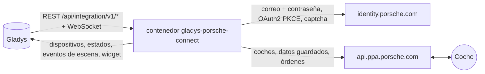
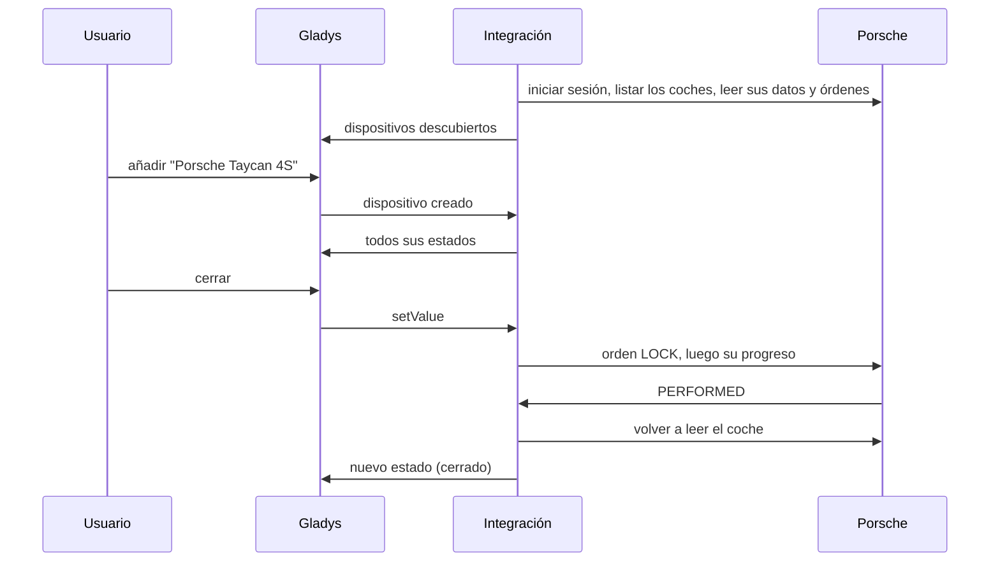
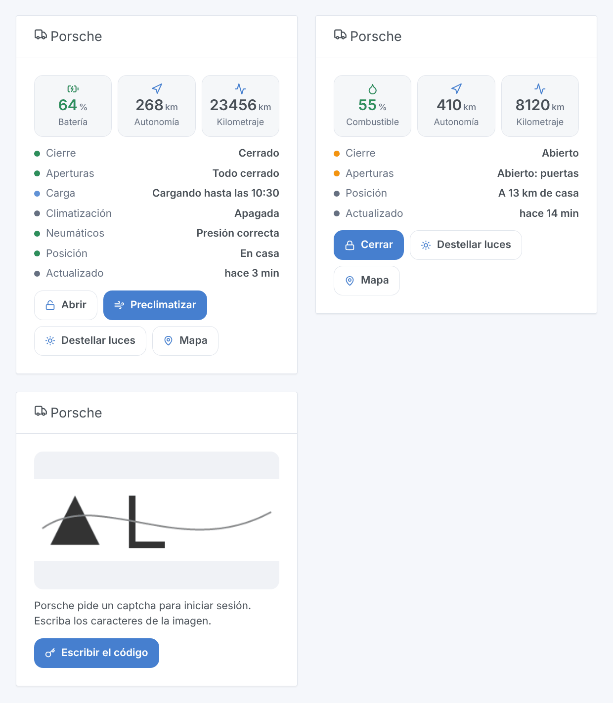

# Gladys Porsche Connect

[English](README.md) · [Français](README.fr.md) · [Deutsch](README.de.md) · **Español**

[](LICENSE)
[](https://github.com/William-De71/gladys-porsche-connect/releases)
[](https://github.com/William-De71/gladys-porsche-connect/actions/workflows/release.yml)
[](https://gladysassistant.com)


Integración externa de [Gladys Assistant](https://gladysassistant.com) para los **coches Porsche con Porsche Connect**: batería o combustible, autonomía, kilometraje, cierre, aperturas, carga, climatización, neumáticos, posición, con órdenes, escenas y un widget de panel. Habla con los servidores de la app My Porsche con su cuenta, como la biblioteca [pyporscheconnectapi](https://github.com/CJNE/pyporscheconnectapi) y su [integración de Home Assistant](https://github.com/CJNE/ha-porscheconnect).

Documentación de usuario: [English](docs/en.md) · [Français](docs/fr.md) · [Deutsch](docs/de.md) · [Español](docs/es.md).

> Integración comunitaria, sin vínculo con Porsche ni respaldo de su parte. Los servidores de la app My Porsche no tienen documentación pública: Porsche puede cambiarlos en cualquier momento.

## Funciones

- **Un dispositivo por coche** de la cuenta: batería y autonomía eléctrica, combustible y autonomía total, kilometraje, cierre, puertas, maletero, capó delantero, ventanillas, techo solar o capota, cable de carga, carga en curso, estado y potencia de carga, objetivo de carga, preclimatización, presión de los cuatro neumáticos, mantenimiento, distancia de casa.
- **Órdenes** cuando el coche las acepta: cerrar, abrir (con el PIN de la app), preclimatización a la temperatura elegida, objetivo de carga, carga inmediata, destellar las luces, claxon y luces.
- **Lecturas que nunca despiertan el coche**: la integración lee los últimos datos que el coche envió a Porsche, cada 15 minutos por defecto.
- **7 activadores de escena**, **2 acciones de escena** y **1 widget** de panel (abajo), que también muestra el **captcha** que Porsche pide a veces al iniciar sesión.
- Un botón **Diagnóstico** que escribe en los registros lo que envía cada coche, sin VIN ni posición.
- Cuatro idiomas en todas partes: inglés, francés, alemán, español.

## Funcionamiento




Del escaneo a una orden:



El inicio de sesión es el de la app: las páginas «identifier first» de Auth0 (correo y luego contraseña), seguidas del intercambio del código (OAuth2 + PKCE). La integración rechaza la propuesta de passkey, guarda los tokens en `/data/session.json` y los renueva: un reinicio no vuelve a iniciar sesión. Cuando Auth0 pide un **captcha**, el inicio de sesión se detiene y el widget del panel muestra la imagen con un formulario; la respuesta reanuda el mismo inicio de sesión (mismas cookies), durante 10 minutos. Una contraseña rechazada, un captcha o una cuenta bloqueada esperan su intervención: la integración nunca los reintenta en bucle.

Cada lectura pide el **resumen guardado** de cada coche (lo que envió al aparcar, durante la carga, tras una orden): nunca lo despierta, así que su batería de 12 V se conserva. Mientras Porsche limita las solicitudes (HTTP 429), las lecturas se espacian (30 minutos, duplicados hasta 4 horas).

### Transporte

`transports: ["cloud"]`: todo pasa por los servidores de Porsche, nunca se accede al coche en su red. El estado de sus coches (posición incluida) viene de la nube de Porsche; la integración envía a Porsche su correo, su contraseña y las órdenes. La insignia de transporte de un coche indica `cloud`, `unreachable` cuando Porsche rechaza la cuenta o espera un captcha, y muestra el punto naranja del modo degradado mientras Porsche limita las solicitudes.

## Dispositivos y funcionalidades

| Dispositivo   | Funcionalidades (categoría / tipo)                                                                                                                                                                                                                                                                                                                                                                                                                                                                                                                                                                                                                                                                                                                                                  |
| ------------- | ----------------------------------------------------------------------------------------------------------------------------------------------------------------------------------------------------------------------------------------------------------------------------------------------------------------------------------------------------------------------------------------------------------------------------------------------------------------------------------------------------------------------------------------------------------------------------------------------------------------------------------------------------------------------------------------------------------------------------------------------------------------------------------- |
| Coche Porsche | batería (`electrical-vehicle-battery` / `battery-level`), autonomía eléctrica (`battery-range-estimate`), nivel de combustible (`level-sensor` / `liquid-level-percent`), autonomía total y distancia al mantenimiento (`distance-sensor` / `decimal`, km), kilometraje (`electrical-vehicle-state` / `odometer`), cierre (`electrical-vehicle-command`), puertas, maletero, capó delantero (`door-opened`), ventanillas, techo solar o capota (`window-opened`), presión de los neumáticos (`tire-pressure`, bar), cable enchufado, carga en curso, potencia de carga, objetivo de carga (`electrical-vehicle-charge`), preclimatización (`electrical-vehicle-climate` / `climate-on`), días hasta el mantenimiento (`duration`), estado de carga (`text`), distancia de casa (km) |

Una funcionalidad aparece en cuanto el coche envía su valor; el dispositivo se vuelve a ofrecer cuando llega una nueva. El cierre, la preclimatización y el objetivo de carga son órdenes cuando el coche las acepta, y solo lectura en caso contrario.

## Activadores, acciones de escena y widgets



- **Activadores**: cerrado o abierto, cerrado pero abierto, estado de carga cambiado, cable enchufado o desenchufado, llegada o salida de casa (viviendas de Gladys con una posición, radio de la vivienda de los ajustes), presión de neumáticos baja, problema de cuenta (contraseña, captcha, cuenta bloqueada, demasiadas solicitudes). Cada activador de coche puede filtrarse por coche; se detectan en la siguiente lectura.
- **Acciones**: enviar una orden (espera hasta 100 s a que el coche la ejecute: `success`, `status`, `summary`), leer el estado (cierre, aperturas, batería, combustible, autonomía, carga, neumáticos, posición, enlace al mapa, una frase lista para usar).
- **Widget** «Porsche»: batería o combustible, autonomía, kilometraje, lista de estados, botones cerrar/abrir, preclimatizar, destellar las luces, mapa; el captcha y su formulario cuando Porsche lo pide.

Ejemplos:

- Cuando el coche está cerrado pero abierto → enviar una notificación con `{{triggerEvent.data.summary}}`.
- Cuando el estado de carga pasa a «Carga completada» → avisar y apagar el enchufe de carga.
- Las mañanas de invierno a las 7:30 los días laborables → enviar la orden «Iniciar la preclimatización».
- Cuando un problema de cuenta es «Captcha por escribir» → enviarme un mensaje para abrir el panel.

## Requisitos

- Gladys Assistant **5.2.0** o posterior (el formulario del captcha en el widget): las instancias más antiguas no pueden instalar la integración.
- Un Porsche con un contrato Porsche Connect activo (Taycan, Macan eléctrico, 911 desde el 992, 718, Panamera desde 2021, Cayenne desde 2017) y la cuenta de la app My Porsche.
- El widget **Porsche** en un panel, para responder a un captcha.

## Instalación

- **Desde la tienda**: Integraciones → Porsche Connect → Instalar.
- **Desde la URL del repositorio**: Integraciones → integración externa → `https://github.com/William-De71/gladys-porsche-connect`.
- **Modo desarrollador**: ejecute `npm start` con las variables que da Gladys (ver Desarrollo).

## Configuración

| Campo                           | Por defecto | Significado                                                           |
| ------------------------------- | ----------- | --------------------------------------------------------------------- |
| Correo electrónico / Contraseña | —           | La cuenta My Porsche (la contraseña es un `secret`)                   |
| PIN (4 cifras)                  | —           | El PIN de la app, solo para abrir desde Gladys                        |
| Intervalo de lectura            | 15 min      | 10, 15, 30 o 60 minutos entre dos lecturas                            |
| Temperatura de preclimatización | 21 °C       | De 18 a 24 °C, dentro del rango que acepta el coche                   |
| Radio de la vivienda            | 200 m       | Distancia a una vivienda de Gladys bajo la cual el coche está en casa |
| Idioma de los textos            | automático  | Nombres, estados y resúmenes de escenas                               |

## Uso

1. Añada el widget **Porsche** a un panel.
2. Indique la cuenta, haga clic en **Guardar** y luego en **Probar la conexión**. Si el widget muestra un captcha, escríbalo allí.
3. **Descubra** y añada sus coches, y cree escenas con los activadores y las acciones.

## Desarrollo

```bash
npm install
npm test                       # node --test, never touches the network
npm run lint                   # ESLint
npm run format:check           # Prettier
npx github:GladysAssistant/integration-store . --skip-image-check
scripts/build-cover.sh         # cover.jpg from docs/assets/cover.svg
docs/illustrations/render.sh   # docs/assets/widgets.<lang>.png
```

En local, el SDK lee `GLADYS_HOST_API_URL`, `GLADYS_INTEGRATION_TOKEN` y `GLADYS_INTEGRATION_SELECTOR` (que da Gladys en modo desarrollador). `DEBUG=gladys-integration-sdk` muestra los registros del SDK.

Las pruebas se ejecutan contra una nube Porsche falsa (`test/helpers/fixtures.js`: páginas Auth0 con captcha y passkey, endpoint de tokens, API PPA con órdenes), reconstruida a partir del código de pyporscheconnectapi y evcc: pasos del inicio de sesión (captcha, passkey, contraseña incorrecta, renovación, sesión guardada), órdenes y su progreso, el hash del PIN, las instantáneas, los dispositivos (los campos que exige la pantalla Descubrir, pares categoría / tipo y unidades del núcleo), el widget (`validateWidgetContent`, `validateWidgetImage`), los eventos y salidas de escena, el manifiesto, los cuatro idiomas, el script de release y la integración completa frente al Gladys falso del SDK. `test/structure.test.js` congela todas las claves que guardan los usuarios.

## Proceso de release


Cada fusión en `main` lanza la CI y luego calcula la versión a partir de los [Conventional Commits](https://www.conventionalcommits.org/) desde la última etiqueta: `feat` → menor, `fix` / `perf` → parche, `!` o `BREAKING CHANGE` → mayor (una menor por debajo de 1.0.0); `docs`, `chore`, `ci`, `test`, `style`, `refactor`, `build` solos no publican nada. Se genera la sección del changelog, se sube la etiqueta, se construye la imagen multiarquitectura, luego `main` recibe el commit de release, se crea la GitHub Release y un último job comprueba la imagen pública, el validador de la tienda y el topic.

- El título de la pull request se convierte en el commit de squash y luego en la línea del changelog: escríbalo en inglés, para el usuario (`pr-title.yml` lo comprueba). No edite nunca `CHANGELOG.md` a mano.
- La 1.0.0 es una decisión: Actions → Release → Run workflow con `release-as: 1.0.0`. `dry-run` muestra la versión y las notas sin publicar.
- **Rama protegida**: la release sube su commit a `main` con `GITHUB_TOKEN`. Con un ruleset en `main` que exija pull requests o comprobaciones de estado, añada GitHub Actions a su lista de omisión (o suba mediante una GitHub App); si no, el job de publicación falla con instrucciones.
- Tras la primera release, haga público el paquete `ghcr.io` (Package settings → Change visibility); si no, Gladys no puede descargarlo.

## Solución de problemas

Ver [docs/es.md](docs/es.md#solución-de-problemas). Informe de los problemas con las versiones de Gladys y de la integración, el modelo y el año del coche, y los registros tras un clic en **Diagnóstico**.

## Contribuir

Issues y pull requests son bienvenidas. Ejecute `npm run format:check && npm run lint && npm test` antes de abrir una pull request y mantenga sin cambios todos los external ids y claves guardadas (ver [CLAUDE.md](CLAUDE.md)). Cuando Porsche cambie su inicio de sesión o la identidad de su app, siga el proyecto pyporscheconnectapi y actualice `src/porsche/`.

## Seguridad

Ver [SECURITY.md](SECURITY.md): informe de las vulnerabilidades en privado. La contraseña y el PIN son campos `secret`, nunca registrados; los tokens quedan en `/data/session.json` (modo 600); un VIN se acorta en los registros, y el Diagnóstico omite el VIN y la posición.

## Capturas por venir

Las imágenes de arriba son ilustraciones, no capturas de pantalla. Las capturas reales irán en `docs/assets/screenshots/` (PNG, 1280 × 800): `configuration.png`, `discovery.png`, `device.png`, `scene.png`, `captcha.png`.

## Licencia

[Licencia Apache 2.0](LICENSE) — ver también [NOTICE](NOTICE). Porsche, Porsche Connect y My Porsche son marcas de Dr. Ing. h.c. F. Porsche AG; esta integración comunitaria no está vinculada a ella. Gracias a la documentación y al SDK de Gladys, y a Johan Isacsson y los contribuidores de pyporscheconnectapi y ha-porscheconnect.
