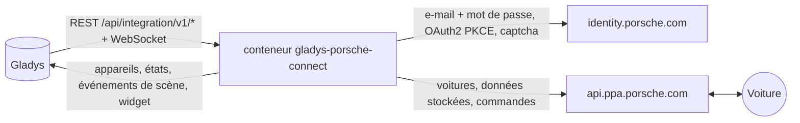
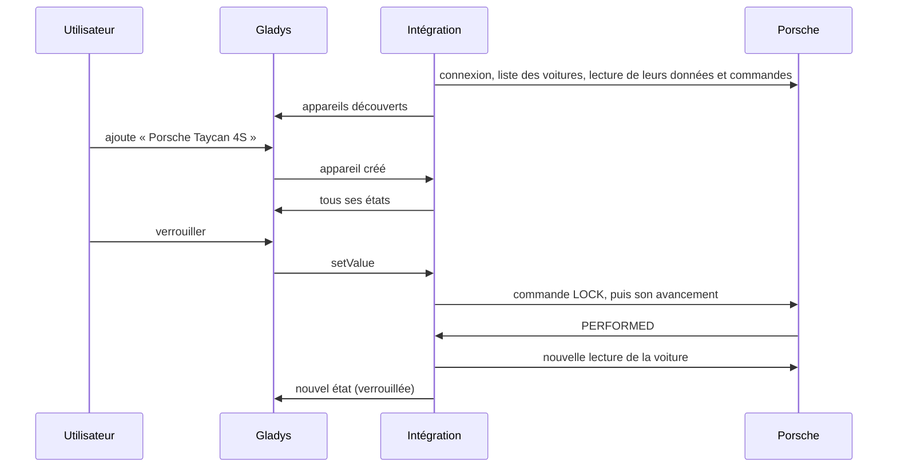
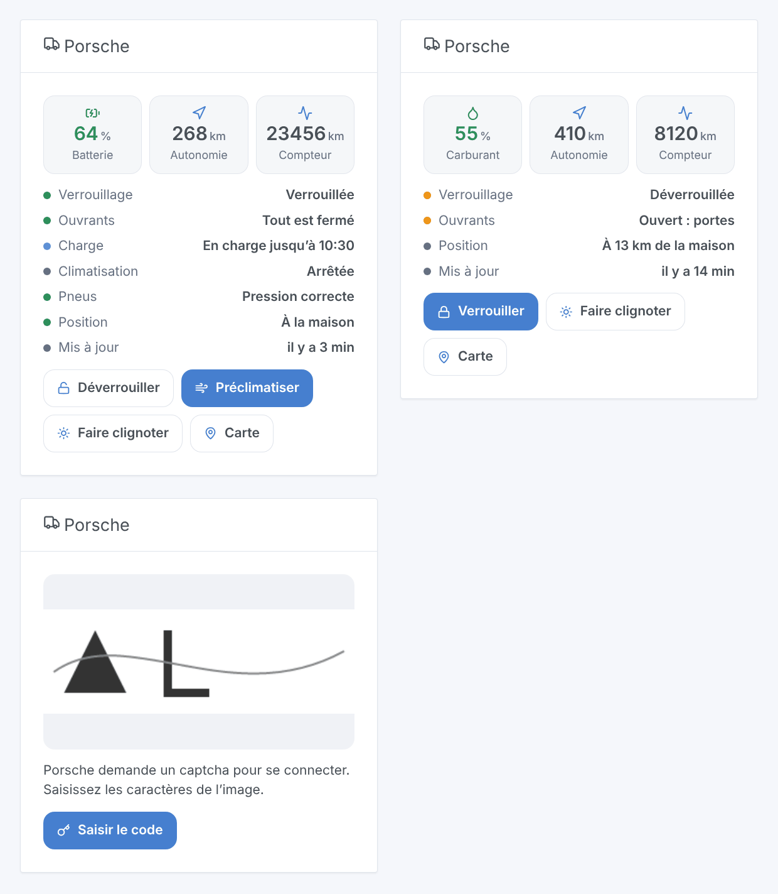

# Gladys Porsche Connect

[English](README.md) · **Français** · [Deutsch](README.de.md) · [Español](README.es.md)

[](LICENSE)
[](https://github.com/William-De71/gladys-porsche-connect/releases)
[](https://github.com/William-De71/gladys-porsche-connect/actions/workflows/release.yml)
[](https://gladysassistant.com)


Intégration externe de [Gladys Assistant](https://gladysassistant.com) pour les **Porsche dotées de Porsche Connect** : batterie ou carburant, autonomie, kilométrage, verrouillage, ouvrants, charge, climatisation, pneus, position, avec des commandes, des scènes et un widget de tableau de bord. Elle dialogue avec les serveurs de l’app My Porsche avec votre compte, comme la bibliothèque [pyporscheconnectapi](https://github.com/CJNE/pyporscheconnectapi) et son [intégration Home Assistant](https://github.com/CJNE/ha-porscheconnect).

Documentation utilisateur : [English](docs/en.md) · [Français](docs/fr.md) · [Deutsch](docs/de.md) · [Español](docs/es.md).

> Intégration communautaire, ni affiliée à Porsche ni approuvée par elle. Les serveurs de l’app My Porsche n’ont pas de documentation publique : Porsche peut les modifier à tout moment.

## Fonctionnalités

- **Un appareil par voiture** du compte : batterie et autonomie électrique, carburant et autonomie totale, kilométrage, verrouillage, portes, coffre, capot avant, fenêtres, toit ouvrant ou capote, câble de charge, charge en cours, état et puissance de charge, objectif de charge, préclimatisation, pression des quatre pneus, entretien, distance du domicile.
- **Commandes** quand la voiture les accepte : verrouiller, déverrouiller (avec le code PIN de l’app), préclimatisation à la température choisie, objectif de charge, charge immédiate, clignotement des feux, klaxon et feux.
- **Des lectures qui ne réveillent jamais la voiture** : l’intégration lit les données que la voiture a envoyées en dernier à Porsche, toutes les 15 minutes par défaut.
- **7 déclencheurs de scène**, **2 actions de scène** et **1 widget** de tableau de bord (ci-dessous), qui affiche aussi le **captcha** que Porsche demande parfois à la connexion.
- Un bouton **Diagnostic** qui écrit dans les journaux ce que remonte chaque voiture, sans VIN ni position.
- Quatre langues partout : anglais, français, allemand, espagnol.

## Fonctionnement




Du scan à une commande :



La connexion est celle de l’app : les pages « identifier first » d’Auth0 (e-mail, puis mot de passe), puis l’échange du code (OAuth2 + PKCE). L’intégration décline la proposition de passkey, garde les jetons dans `/data/session.json` et les renouvelle : un redémarrage ne refait pas de connexion. Quand Auth0 demande un **captcha**, la connexion se met en pause et le widget de tableau de bord en affiche l’image avec un formulaire ; la réponse reprend la même connexion (mêmes cookies), pendant 10 minutes. Un mot de passe refusé, un captcha ou un compte bloqué attendent votre intervention : l’intégration ne les retente jamais en boucle.

Chaque lecture demande l’**aperçu stocké** de chaque voiture (ce qu’elle a envoyé en se garant, pendant la charge, après une commande) : elle ne réveille jamais la voiture, ce qui épargne sa batterie 12 V. Tant que Porsche limite les requêtes (HTTP 429), les lectures sont espacées (30 minutes, doublées jusqu’à 4 heures).

### Transport

`transports: ["cloud"]` : tout passe par les serveurs Porsche, la voiture n’est jamais jointe sur votre réseau. L’état de vos voitures (position comprise) vient du cloud Porsche ; l’intégration envoie à Porsche votre e-mail, votre mot de passe et les commandes. Le badge de transport d’une voiture indique `cloud`, `unreachable` quand Porsche refuse le compte ou attend un captcha, et affiche le point orange du mode dégradé tant que Porsche limite les requêtes.

## Appareils et fonctionnalités

| Appareil        | Fonctionnalités (catégorie / type)                                                                                                                                                                                                                                                                                                                                                                                                                                                                                                                                                                                                                                                                                                                                                |
| --------------- | --------------------------------------------------------------------------------------------------------------------------------------------------------------------------------------------------------------------------------------------------------------------------------------------------------------------------------------------------------------------------------------------------------------------------------------------------------------------------------------------------------------------------------------------------------------------------------------------------------------------------------------------------------------------------------------------------------------------------------------------------------------------------------- |
| Voiture Porsche | batterie (`electrical-vehicle-battery` / `battery-level`), autonomie électrique (`battery-range-estimate`), niveau de carburant (`level-sensor` / `liquid-level-percent`), autonomie totale et distance avant l’entretien (`distance-sensor` / `decimal`, km), kilométrage (`electrical-vehicle-state` / `odometer`), verrouillage (`electrical-vehicle-command`), portes, coffre, capot avant (`door-opened`), fenêtres, toit ouvrant ou capote (`window-opened`), pression des pneus (`tire-pressure`, bar), câble branché, charge en cours, puissance de charge, objectif de charge (`electrical-vehicle-charge`), préclimatisation (`electrical-vehicle-climate` / `climate-on`), jours avant l’entretien (`duration`), état de la charge (`text`), distance du domicile (km) |

Une fonctionnalité apparaît dès que la voiture remonte sa valeur ; l’appareil est proposé à nouveau quand une nouvelle arrive. Verrouillage, préclimatisation et objectif de charge sont des commandes quand la voiture les accepte, en lecture seule sinon.

## Déclencheurs, actions de scène et widgets



- **Déclencheurs** : verrouillée ou déverrouillée, verrouillée mais ouverte, état de la charge modifié, câble branché ou débranché, arrivée ou départ du domicile (maisons de Gladys avec une position, rayon du domicile des réglages), pression des pneus basse, problème de compte (mot de passe, captcha, compte bloqué, trop de requêtes). Chaque déclencheur de voiture peut être filtré par voiture ; ils sont vus à la lecture suivante.
- **Actions** : envoyer une commande (attend jusqu’à 100 s que la voiture l’exécute : `success`, `status`, `summary`), lire l’état (verrouillage, ouvrants, batterie, carburant, autonomie, charge, pneus, position, lien de carte, une phrase prête).
- **Widget** « Porsche » : batterie ou carburant, autonomie, kilométrage, liste d’états, boutons verrouiller/déverrouiller, préclimatiser, faire clignoter les feux, carte ; le captcha et son formulaire quand Porsche en demande un.

Exemples :

- Quand la voiture est verrouillée mais ouverte → envoyer une notification avec `{{triggerEvent.data.summary}}`.
- Quand l’état de la charge devient « Charge terminée » → prévenir, et couper la prise de charge.
- Les matins d’hiver à 7 h 30 en semaine → envoyer la commande « Lancer la préclimatisation ».
- Quand un problème de compte est « Captcha à saisir » → m’envoyer un message pour ouvrir le tableau de bord.

## Prérequis

- Gladys Assistant **5.2.0** ou plus récent (le formulaire du captcha dans le widget) : les instances plus anciennes ne peuvent pas installer l’intégration.
- Une Porsche avec un contrat Porsche Connect actif (Taycan, Macan électrique, 911 depuis la 992, 718, Panamera depuis 2021, Cayenne depuis 2017) et le compte de l’app My Porsche.
- Le widget **Porsche** sur un tableau de bord, pour répondre à un captcha.

## Installation

- **Depuis le store** : Intégrations → Porsche Connect → Installer.
- **Depuis l’URL du dépôt** : Intégrations → intégration externe → `https://github.com/William-De71/gladys-porsche-connect`.
- **Mode développeur** : lancez `npm start` avec les variables fournies par Gladys (voir Développement).

## Configuration

| Champ                           | Défaut      | Rôle                                                             |
| ------------------------------- | ----------- | ---------------------------------------------------------------- |
| E-mail / Mot de passe           | —           | Le compte My Porsche (le mot de passe est un `secret`)           |
| Code PIN (4 chiffres)           | —           | Le code PIN de l’app, seulement pour déverrouiller depuis Gladys |
| Intervalle de lecture           | 15 min      | 10, 15, 30 ou 60 minutes entre deux lectures                     |
| Température de préclimatisation | 21 °C       | 18 à 24 °C, dans la plage acceptée par la voiture                |
| Rayon du domicile               | 200 m       | Distance d’une maison de Gladys sous laquelle la voiture y est   |
| Langue des textes               | automatique | Noms, états et résumés de scènes                                 |

## Utilisation

1. Ajoutez le widget **Porsche** à un tableau de bord.
2. Renseignez le compte, cliquez sur **Enregistrer**, puis sur **Tester la connexion**. Si le widget affiche un captcha, cliquez sur **Saisir le code** et tapez-le.
3. Ouvrez **Découverte**, ajoutez vos voitures, puis créez des scènes avec les déclencheurs et les actions.

## Développement

```bash
npm install
npm test                       # node --test, never touches the network
npm run lint                   # ESLint
npm run format:check           # Prettier
npx github:GladysAssistant/integration-store . --skip-image-check
scripts/build-cover.sh         # cover.jpg from docs/assets/cover.svg
docs/illustrations/render.sh   # docs/assets/widgets.<lang>.png
```

En local, le SDK lit `GLADYS_HOST_API_URL`, `GLADYS_INTEGRATION_TOKEN` et `GLADYS_INTEGRATION_SELECTOR` (fournis par Gladys en mode développeur). `DEBUG=gladys-integration-sdk` affiche les journaux du SDK.

Les tests tournent contre un faux cloud Porsche (`test/helpers/fixtures.js` : pages Auth0 avec captcha et passkey, point d’accès des jetons, API PPA avec les commandes), reconstitué d’après le code de pyporscheconnectapi et d’evcc : étapes de connexion (captcha, passkey, mauvais mot de passe, rafraîchissement, session stockée), commandes et leur avancement, hachage du code PIN, instantanés, appareils (champs exigés par la Découverte, couples catégorie / type et unités du cœur), widget (`validateWidgetContent`, `validateWidgetImage`), événements et sorties de scène, manifeste, quatre langues, script de release, et toute l’intégration face au faux Gladys du SDK. `test/structure.test.js` fige chaque clé stockée par les utilisateurs.

## Processus de release


Chaque fusion sur `main` lance la CI, puis calcule la version à partir des [Conventional Commits](https://www.conventionalcommits.org/) depuis le dernier tag : `feat` → mineure, `fix` / `perf` → correctif, `!` ou `BREAKING CHANGE` → majeure (une mineure sous 1.0.0) ; `docs`, `chore`, `ci`, `test`, `style`, `refactor`, `build` seuls ne publient rien. La section du changelog est générée, le tag poussé, l’image multi-architecture construite, puis `main` reçoit le commit de release, la GitHub Release est créée et un dernier job vérifie l’image publique, le validateur du store et le topic.

- Le titre de la pull request devient le commit de squash, puis la ligne du changelog : écrivez-le en anglais, pour l’utilisateur (`pr-title.yml` le vérifie). N’éditez jamais `CHANGELOG.md` à la main.
- La 1.0.0 est une décision : Actions → Release → Run workflow avec `release-as: 1.0.0`. `dry-run` affiche la version et les notes sans rien publier.
- **Branche protégée** : la release pousse son commit sur `main` avec `GITHUB_TOKEN`. Avec un ruleset sur `main` qui exige des pull requests ou des vérifications de statut, ajoutez GitHub Actions à sa liste de contournement (ou poussez via une GitHub App), sinon le job de publication échoue avec des instructions.
- Après la première release, rendez public le package `ghcr.io` (Package settings → Change visibility), sinon Gladys ne peut pas le télécharger.

## Dépannage

Voir [docs/fr.md](docs/fr.md#dépannage). Signalez un problème avec les versions de Gladys et de l’intégration, le modèle et l’année de la voiture, et les journaux après un clic sur **Diagnostic**.

## Contribuer

Issues et pull requests bienvenues. Lancez `npm run format:check && npm run lint && npm test` avant d’ouvrir une pull request, et gardez inchangés tous les external ids et clés stockées (voir [CLAUDE.md](CLAUDE.md)). Quand Porsche change sa connexion ou l’identité de son app, suivez le projet pyporscheconnectapi et mettez à jour `src/porsche/`.

## Sécurité

Voir [SECURITY.md](SECURITY.md) : signalez les vulnérabilités en privé. Le mot de passe et le code PIN sont des champs `secret`, jamais journalisés ; les jetons restent dans `/data/session.json` (mode 600) ; un VIN est raccourci dans les journaux, et le Diagnostic omet VIN et position.

## Captures à venir

Les images ci-dessus sont des illustrations, pas des captures d’écran. Les vraies captures iront dans `docs/assets/screenshots/` (PNG, 1280 × 800) : `configuration.png`, `discovery.png`, `device.png`, `scene.png`, `captcha.png`.

## Licence

[Licence Apache 2.0](LICENSE) — voir aussi [NOTICE](NOTICE). Porsche, Porsche Connect et My Porsche sont des marques de Dr. Ing. h.c. F. Porsche AG ; cette intégration communautaire n’y est pas affiliée. Merci à la documentation et au SDK de Gladys, ainsi qu’à Johan Isacsson et aux contributeurs de pyporscheconnectapi et ha-porscheconnect.
