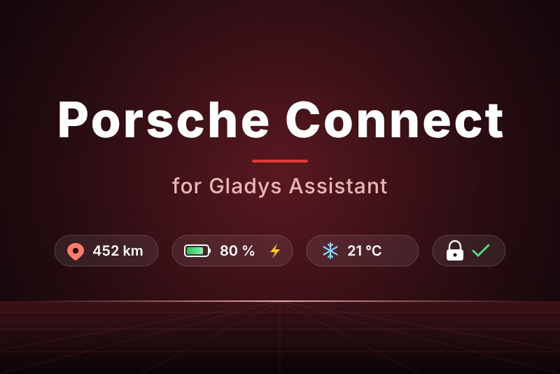
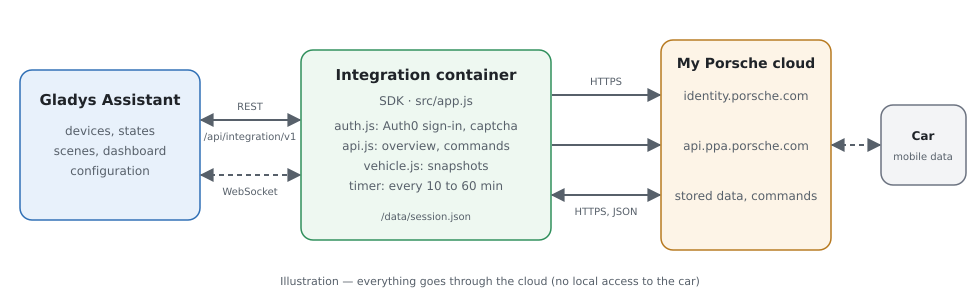
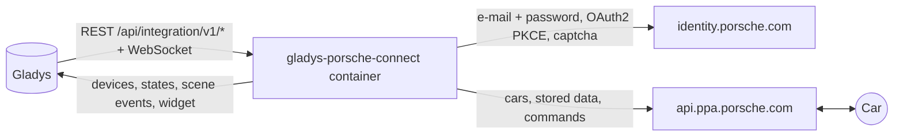
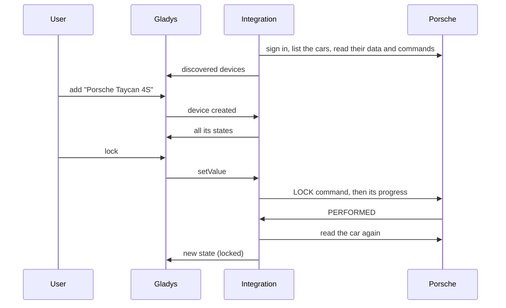
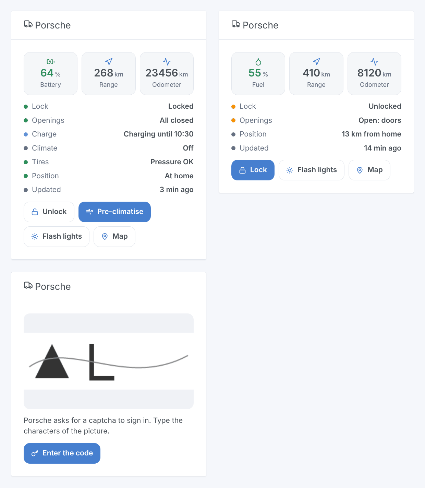

# Gladys Porsche Connect

**English** · [Français](README.fr.md) · [Deutsch](README.de.md) · [Español](README.es.md)

[](LICENSE)
[](https://github.com/William-De71/gladys-porsche-connect/releases)
[](https://github.com/William-De71/gladys-porsche-connect/actions/workflows/release.yml)
[](https://gladysassistant.com)



[Gladys Assistant](https://gladysassistant.com) external integration for **Porsche cars with Porsche Connect**: battery or fuel, range, odometer, lock, openings, charge, climate, tires, position, with commands, scenes and a dashboard widget. It talks to the servers of the My Porsche app with your account, like the [pyporscheconnectapi](https://github.com/CJNE/pyporscheconnectapi) library and its [Home Assistant integration](https://github.com/CJNE/ha-porscheconnect).

User documentation: [English](docs/en.md) · [Français](docs/fr.md) · [Deutsch](docs/de.md) · [Español](docs/es.md).

> Community integration, not affiliated with nor endorsed by Porsche. The servers of the My Porsche app have no public documentation: Porsche can change them at any time.

## Features

- **One device per car** of the account: battery and electric range, fuel and total range, odometer, lock, doors, trunk, front lid, windows, sunroof or top, charging cable, charging, charging status and power, charge target, pre-climatisation, four tire pressures, service, distance from home.
- **Commands** where the car accepts them: lock, unlock (with the PIN of the app), pre-climatisation at the chosen temperature, charge target, direct charge, flash the lights, horn and lights.
- **Readings that never wake the car**: the integration reads the data the car last sent to Porsche, every 15 minutes by default.
- **7 scene triggers**, **2 scene actions** and **1 dashboard widget** (below), which also shows the **captcha** Porsche sometimes asks for at the sign-in.
- A **Diagnostic** button that writes what each car reports to the logs, without VIN nor position.
- Four languages everywhere: English, French, German, Spanish.

## How it works





From the scan to a command:



The sign-in is the one of the app: the "identifier first" pages of Auth0 (e-mail, then password), then the code exchange (OAuth2 + PKCE). The integration declines the passkey offer, keeps the tokens in `/data/session.json` and refreshes them: a restart does not sign in again. When Auth0 asks for a **captcha**, the sign-in pauses and the dashboard widget shows the picture with a form; the answer resumes the same login (same cookies), for 10 minutes. A refused password, a captcha or a locked account wait for you: the integration never retries them in a loop.

Every reading asks the **stored overview** of each car (what it sent when it parked, while charging, after a command): it never wakes the car, so its 12 V battery is spared. While Porsche limits the requests (HTTP 429), the readings are spaced out (30 minutes, doubled up to 4 hours).

### Transport

`transports: ["cloud"]`: everything goes through the Porsche servers, the car is never reached on your network. The state of your cars (position included) comes from the Porsche cloud; the integration sends Porsche your e-mail, password and the commands. The transport badge of a car says `cloud`, `unreachable` when Porsche refuses the account or waits for a captcha, and shows the orange dot of the degraded mode while Porsche limits the requests.

## Devices and features

| Device      | Features (category / type)                                                                                                                                                                                                                                                                                                                                                                                                                                                                                                                                                                                                                                                                     |
| ----------- | ---------------------------------------------------------------------------------------------------------------------------------------------------------------------------------------------------------------------------------------------------------------------------------------------------------------------------------------------------------------------------------------------------------------------------------------------------------------------------------------------------------------------------------------------------------------------------------------------------------------------------------------------------------------------------------------------- |
| Porsche car | battery (`electrical-vehicle-battery` / `battery-level`), electric range (`battery-range-estimate`), fuel level (`level-sensor` / `liquid-level-percent`), total range and distance to service (`distance-sensor` / `decimal`, km), odometer (`electrical-vehicle-state` / `odometer`), lock (`electrical-vehicle-command`), doors, trunk, front lid (`door-opened`), windows, sunroof or top (`window-opened`), tire pressures (`tire-pressure`, bar), cable plugged, charging, charging power, charge target (`electrical-vehicle-charge`), pre-climatisation (`electrical-vehicle-climate` / `climate-on`), days to service (`duration`), charging status (`text`), distance from home (km) |

A feature appears once the car reports its value; the device is offered again when a new one shows up. Lock, pre-climatisation and charge target are commands when the car accepts them, read-only otherwise.

## Scene triggers, actions and widgets



- **Triggers**: locked or unlocked, locked but left open, charging status changed, cable plugged or unplugged, arrived home or left (houses of Gladys with a position, home radius of the settings), tire pressure low, account problem (password, captcha, locked account, too many requests). Each car trigger can be filtered by car; they are seen at the next reading.
- **Actions**: send a command (waits up to 100 s for the car to run it: `success`, `status`, `summary`), read the status (lock, openings, battery, fuel, range, charge, tires, position, map link, a ready sentence).
- **Widget** "Porsche": battery or fuel, range, odometer, status list, buttons lock/unlock, pre-climatise, flash the lights, map; the captcha and its form when Porsche asks for one.

Examples:

- When the car is locked but left open → send a notification with `{{triggerEvent.data.summary}}`.
- When the charging status becomes "Charging completed" → notify, and switch the charging socket off.
- On winter mornings at 7:30 on working days → send the command "Start the pre-climatisation".
- When an account problem is "Captcha to type" → send me a message to open the dashboard.

## Requirements

- Gladys Assistant **5.2.0** or later (the captcha form of the widget): older instances cannot install the integration.
- A Porsche with an active Porsche Connect contract (Taycan, Macan Electric, 911 from the 992, 718, Panamera from 2021, Cayenne from 2017) and the account of the My Porsche app.
- The **Porsche** widget on a dashboard, to answer a captcha.

## Installation

- **From the store**: Integrations → Porsche Connect → Install.
- **From the repository URL**: Integrations → external integration → `https://github.com/William-De71/gladys-porsche-connect`.
- **Developer mode**: run `npm start` with the variables given by Gladys (see Development).

## Configuration

| Field                         | Default   | Meaning                                                     |
| ----------------------------- | --------- | ----------------------------------------------------------- |
| E-mail / Password             | —         | The My Porsche account (the password is a `secret`)         |
| PIN (4 digits)                | —         | The PIN of the app, only to unlock from Gladys              |
| Reading interval              | 15 min    | 10, 15, 30 or 60 minutes between two readings               |
| Pre-climatisation temperature | 21 °C     | 18 to 24 °C, within the range the car accepts               |
| Home radius                   | 200 m     | Distance from a house of Gladys under which the car is home |
| Language of the texts         | automatic | Names, states and scene summaries                           |

## Usage

1. Add the **Porsche** widget to a dashboard.
2. Fill in the account, click **Save**, then **Test the connection**. If the widget shows a captcha, type it there.
3. **Discover**, then add your cars, and build scenes with the triggers and actions.

## Development

```bash
npm install
npm test                       # node --test, never touches the network
npm run lint                   # ESLint
npm run format:check           # Prettier
npx github:GladysAssistant/integration-store . --skip-image-check
scripts/build-cover.sh         # cover.jpg from docs/assets/cover.svg
docs/illustrations/render.sh   # docs/assets/widgets.<lang>.png
```

Locally, the SDK reads `GLADYS_HOST_API_URL`, `GLADYS_INTEGRATION_TOKEN` and `GLADYS_INTEGRATION_SELECTOR` (given by Gladys in developer mode). `DEBUG=gladys-integration-sdk` shows the SDK logs.

The tests run against a fake Porsche cloud (`test/helpers/fixtures.js`: Auth0 pages with captcha and passkey, token endpoint, PPA API with commands), reconstructed from the code of pyporscheconnectapi and evcc: sign-in steps (captcha, passkey, wrong password, refresh, stored session), commands and their progress, the PIN hash, the snapshots, the devices (the fields the Discovery screen requires, category / type pairs and units of the core), the widget (`validateWidgetContent`, `validateWidgetImage`), the scene events and outputs, the manifest, the four languages, the release script, and the whole integration against the fake Gladys of the SDK. `test/structure.test.js` freezes every key users store.

## Release process


Every merge on `main` runs the CI, then computes the version from the [Conventional Commits](https://www.conventionalcommits.org/) since the last tag: `feat` → minor, `fix` / `perf` → patch, `!` or `BREAKING CHANGE` → major (a minor below 1.0.0); `docs`, `chore`, `ci`, `test`, `style`, `refactor`, `build` alone publish nothing. The changelog section is generated, the tag pushed, the multi-architecture image built, then `main` receives the release commit, the GitHub Release is created and a last job checks the public image, the store validator and the topic.

- The pull request title becomes the squash commit, then the changelog line: write it in English, for the user (`pr-title.yml` checks it). Never edit `CHANGELOG.md` by hand.
- 1.0.0 is a decision: Actions → Release → Run workflow with `release-as: 1.0.0`. `dry-run` shows the version and the notes without publishing.
- **Protected branch**: the release pushes its commit to `main` with `GITHUB_TOKEN`. With a ruleset on `main` that requires pull requests or status checks, add GitHub Actions to its bypass list (or push through a GitHub App), otherwise the publish job fails with instructions.
- After the first release, make the `ghcr.io` package public (Package settings → Change visibility), or Gladys cannot pull it.

## Troubleshooting

See [docs/en.md](docs/en.md#troubleshooting). Report issues with the versions of Gladys and of the integration, the model and year of the car, and the logs after a click on **Diagnostic**.

## Contributing

Issues and pull requests are welcome. Run `npm run format:check && npm run lint && npm test` before opening a pull request, and keep every external id and stored key unchanged (see [CLAUDE.md](CLAUDE.md)). When Porsche changes its sign-in or its app identity, follow the pyporscheconnectapi project and update `src/porsche/`.

## Security

See [SECURITY.md](SECURITY.md): report vulnerabilities privately. The password and the PIN are `secret` fields, never logged; the tokens stay in `/data/session.json` (mode 600); a VIN is shortened in the logs, and the Diagnostic leaves out VIN and position.

## Screenshots to come

The images above are illustrations, not screenshots. Real screenshots will go in `docs/assets/screenshots/` (PNG, 1280 × 800): `configuration.png`, `discovery.png`, `device.png`, `scene.png`, `captcha.png`.

## License

[Apache License 2.0](LICENSE) — see also [NOTICE](NOTICE). Porsche, Porsche Connect and My Porsche are trademarks of Dr. Ing. h.c. F. Porsche AG; this community integration is not affiliated with it. Thanks to the Gladys documentation and SDK, and to Johan Isacsson and the contributors of pyporscheconnectapi and ha-porscheconnect.
